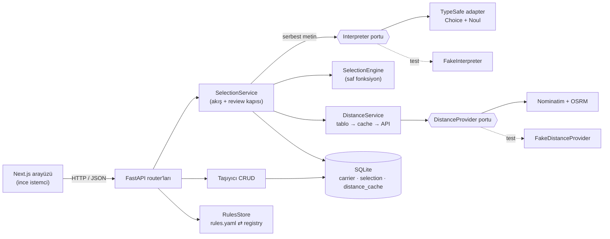
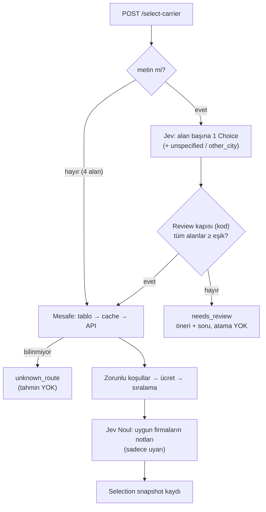

# Carrier Selector

İşe alım case çalışması, **Case 1: Taşıyıcı Seçimi**. Gelen bir konteyner taşıma siparişi için en uygun taşıyıcıyı seçer, ücreti hesaplar, kararını gerekçelendirir ve her kararı değişmez bir kayıt olarak saklar. Serbest metin siparişleri **Jev (TypeSafe)** yorumlar; **karar her zaman deterministik Python kodundadır**.

> Tek cümlede: *Jev metni okur ve ne kadar emin olduğunu söyler; kod karar verir; model emin değilse sistem tahmin etmez, kullanıcıya sorar.*

---

## İçindekiler
1. [Mimari](#mimari)
2. [Jev'in rolü ve deterministik kod](#jevin-rolü-ve-deterministik-kod)
3. [Confidence davranışı](#confidence-davranışı)
4. [Seçim algoritması ve kural seti](#seçim-algoritması-ve-kural-seti)
5. [Mesafe yönetimi](#mesafe-yönetimi)
6. [Teknoloji seçimleri](#teknoloji-seçimleri)
7. [Klasör yapısı](#klasör-yapısı)
8. [Kurulum ve çalıştırma](#kurulum-ve-çalıştırma)
9. [API](#api)
10. [Testler](#testler)
11. [Güvenlik](#güvenlik)
12. [Bilinen sınırlar](#bilinen-sınırlar)

Kararların gerekçeleri: [`docs/adr/`](docs/adr) · Terim sözlüğü: [`CONTEXT.md`](CONTEXT.md) · Spec: [`docs/specs/0001-carrier-selection.md`](docs/specs/0001-carrier-selection.md) · Canlı demo senaryosu: [`docs/demo.md`](docs/demo.md)

---

## Mimari



**Sipariş akışı**



Modüller tek sorumluluklu ve test edilebilir tasarlandı. Dış dünyaya bağlanan iki yer (Jev ve mesafe API'si) **port** arkasında; testlerde sahteleriyle değiştiriliyor.

| Modül | Sorumluluk |
|---|---|
| `engine/` | Saf karar motoru: `Constraint` ve `RankingCriterion` sınıfları (Strategy pattern), registry, sıralama, gerekçeler. I/O yok. |
| `services/selection.py` | Akış: girdiyi doğrula → (metinse) Jev + review kapısı → mesafe → motor → not uyarıları → snapshot. |
| `services/distance.py` | Mesafe çözümü; asla tahmin etmez (ADR 0003). |
| `services/typesafe_interpreter.py` | Jev adapter'ı; sadece "ne okudum, ne kadar eminim". |
| `services/rules_store.py` | `rules.yaml` okuma/yazma ve doğrulama (ADR 0002). |
| `messages.py` | Tüm Türkçe metinler tek yerde. |

## Jev'in rolü ve deterministik kod

Jev, TypeSafe'in **System One** modelidir: serbest metin üretmez; verilen seçenekler arasından seçim yapar ve **kalibre edilmiş olasılık + confidence** döndürür. Bu yüzden genel amaçlı bir JSON üreticisi gibi değil, **soru-cevap ilkelleri** (primitives) ile kullanılır (ADR 0001).

| Nerede | Jev ilkeli | Soru | Ne döner |
|---|---|---|---|
| Serbest metin sipariş | **Choice** × 4 (tek istekte) | Çıkış / varış şehri (bilinen şehirler + `other_city` + `unspecified`), konteyner (20/40/45 + `unspecified`), yük tipi (Dry/Reefer/Hazardous + `unspecified`) | Seçilen etiket + confidence |
| Firma notu | **Noul** × not sayısı (tek istekte) | "Bu not, bu sipariş için bir kısıt/risk belirtiyor mu?" | Evet olasılığı (0–1) |

**Deterministik kodda kalan her şey:**
- Review kararı (eşik karşılaştırması, `unspecified` / `other_city` / confidence yok)
- Zorunlu koşullar (mesafe aralığı, konteyner, yük tipi, aktiflik)
- Ücret hesabı (`mesafe × $/mil`, `Decimal`, kuruşa yuvarlama)
- Sıralama, eşitlik bozma (en son firma adı), "neden kaybetti" açıklaması
- Not uyarısı eşiği (uyarı seçimi **asla** değiştirmez)

Deterministik kod "hata yapmaz" demiyoruz: **aynı girdi ve aynı kural setiyle her zaman aynı sonucu üretir**, test edilebilir ve denetlenebilir. Yazılım hatalarına karşı korumayı 105 test sağlıyor.

**Neden `unspecified` seçeneği?** Jev'i belirtilmemiş bir alan için bir değer seçmeye zorlamamak için. Örneğin *"Need a reefer box from Ft. Lauderdale to Miami"* metninde boyut yok; Jev `unspecified` (güven 1.00) der ve sistem soru sorar. Bu, TypeSafe dokümanlarındaki "sentinel seçenek" kalıbıdır.

## Confidence davranışı

| Durum | Davranış |
|---|---|
| Tüm alanlar kabul (değer somut ve güven ≥ `field_confidence`, varsayılan **0.75**) | Normal seçim; yanıtta alan bazında güven ve `min` (en zayıf alan) |
| Bir alan bile belirsiz (düşük güven, `unspecified`, `other_city` veya güven yok) | `status: needs_review`, **taşıyıcı atanmaz**; `review.fields`, `review.suggestions`, Türkçe soru. Arayüz formu Jev'in okuduklarıyla doldurur, belirsiz alanı vurgular. |
| Jev'e ulaşılamıyor / anahtar yok | `status: jev_unavailable`; arayüz forma yönlendirir. **Yapılandırılmış siparişler etkilenmez.** |
| Not kontrolü yapılamadı | Seçim yine yapılır, `notes_checked: false` |

Neden ortalama değil **en zayıf alan**? Bir alan 0.99, diğeri 0.40 olabilir; ortalama bu riski gizler. 0.75 kesin bir standart değil, `rules.yaml`'dan değişen bir başlangıç eşiği.

## Seçim algoritması ve kural seti

1. **Zorunlu koşullar** (`rules.yaml → constraints`): aktiflik, mesafe aralığı (**sınırlar dahil**: ≤ 300, ≥ 250), konteyner, yük tipi. Elenen firmanın **tüm** gerekçeleri listelenir.
2. **Ücret**: `rota mesafesi × mil başına ücret`.
3. **Sıralama** (`rules.yaml → ranking`, açık kriterler sırayla): varsayılan `total_cost`, sonra `hq_proximity` (firma merkezinin çıkış şehrine uzaklığı; bilinmiyorsa sona). Hepsi eşitse firma adı.
4. Uygun firma yoksa `no_carrier` ve her firmanın gerekçesi.

Yanıtta iki ayrı liste var: **`rejected_carriers`** (bir koşulu sağlamayanlar) ve **`eligible_carriers`** (uygun ama sıralamada geride kalanlar, "neden kaybetti" ile). "Ücreti daha yüksek" bir firma elenmiş değildir; bu ayrım bilinçli.

```yaml
# rules.yaml (tek doğruluk kaynağı, ADR 0002)
constraints: [active, distance_range, container_size, cargo_type]
ranking:
  - name: total_cost
    enabled: true
  - name: hq_proximity
    enabled: true
thresholds:
  field_confidence: 0.75
  note_warning: 0.7
```

**Yeni kriter eklemek** (ör. `reliability`):
1. `backend/app/engine/ranking.py` içinde bir sınıf yaz (`key()` küçük olan iyi; yüksek güvenilirlik için `-reliability`), değeri firmanın `attributes` alanından oku.
2. `RANKING_CRITERIA` registry'sine ekle.
3. `rules.yaml`'a adını yaz veya arayüzden aç. Başka hiçbir dosya değişmez; veritabanı şeması da değişmez.

Firma adları veya özellikleri karar kodunda hiçbir yerde geçmez; firmalar veritabanından gelir.

## Mesafe yönetimi

Sıra: **case tablosu (simetrik) → veritabanı cache'i → Nominatim (geocoding) + OSRM (yol mesafesi)**. Hiçbiri cevap veremezse `unknown_route`; **tahmin yok** (ADR 0003).

- Kuş uçuşu (haversine) bilerek kullanılmadı: Miami–Orlando kuş uçuşu ~205 mil, yol 235 mil; fiyatı sessizce %13 düşük gösterirdi.
- Gerçek API, case tablosuyla tutarlı: Miami → Orlando **233.3** mil (tablo 235), Miami → Atlanta **660.6** mil (tablo 660).
- Anahtarsız public servisler (SLA yok): 5 sn timeout, açıklayıcı User-Agent, saniyede en fazla 1 geocoding isteği; her hata `unknown_route` olur. Başarılı sonuçlar cache'lenir.
- Merkez şehri ölçülemeyen bir firma kaydedilebilir ama uyarı alır (merkez yakınlığında sona kalır).
- Canlı demodan önce `python -m app.warm_cache` ile kullanılacak rotalar cache'e alınır; demo internete bağımlı kalmaz.

## Teknoloji seçimleri

| Katman | Seçim | Neden |
|---|---|---|
| Backend | **FastAPI** + Pydantic | Tip güvenli doğrulama ve otomatik OpenAPI; Jev'in tip güvenli yaklaşımıyla aynı dil |
| Veritabanı | **SQLite** + SQLModel | Kurulumsuz; tek satır bağlantı adresiyle PostgreSQL'e geçilebilir |
| Kural seti | `rules.yaml` + ruamel.yaml | Okunabilir tek kaynak; kaydederken yorumlar korunur |
| AI | **Jev** (`typesafe-sdk`) | Choice/Noul ile tipli kararlar ve kalibre confidence |
| Mesafe | Nominatim + OSRM | Anahtarsız gerçek yol mesafesi; ikinci bir sır yönetmeye gerek yok |
| Frontend | **Next.js 16** (App Router) + TypeScript + Tailwind + shadcn/ui | İnce istemci; tipler OpenAPI'den üretilir (`openapi-typescript`), backend'deki bir alan değişirse frontend derlenmez |
| Test | pytest + respx | HTTP seviyesinde testler; dış servisler sahte |

**Neden Next.js, HTMX değil?** Bu proje için Next.js zaten bilinen teknolojiydi, HTMX değil; arayüz beş sayfa ve etkileşimli kural sıralaması istiyor. Tüm iş mantığı Python'da; Next.js yalnızca API'yi gösteriyor ("API-first": aynı `/select-carrier` başka sistemlere de hizmet eder).

## Klasör yapısı

```text
carrier-selector/
├── backend/
│   ├── app/
│   │   ├── main.py                 # app factory (testler sahte bağımlılık verir)
│   │   ├── api/                    # router'lar (ince) + dependency'ler
│   │   ├── core/config.py          # ayarlar (.env), anahtar SecretStr
│   │   ├── database/               # SQLModel tabloları, seed
│   │   ├── data/                   # case mesafeleri ve 4 başlangıç firması
│   │   ├── engine/                 # saf karar motoru (constraints, ranking, selector)
│   │   ├── schemas/                # API sözleşmesi (Pydantic)
│   │   ├── services/               # selection, distance, interpreter portları ve adapter'lar
│   │   ├── messages.py             # Türkçe metinler
│   │   ├── warm_cache.py           # demo öncesi mesafe cache'i
│   │   └── export_openapi.py       # frontend tip üretimi için şema
│   ├── tests/                      # 105 test (HTTP seviyesi + 2 adapter)
│   ├── .env.example
│   └── requirements.txt
├── frontend/
│   ├── app/                        # 5 sayfa + seçim detayı, loading/error sınırları
│   ├── components/                 # carriers, orders, rules, selection, ui (shadcn)
│   └── lib/api/                    # tip güvenli istemci, OpenAPI'den üretilen tipler
├── docs/adr/                       # mimari kararlar (Jev, rules.yaml, mesafe)
├── docs/specs/                     # teknik spec
├── docs/demo.md                    # canlı demo senaryosu
├── rules.yaml                      # kural seti
├── CONTEXT.md                      # terim sözlüğü
└── CLAUDE.md
```

## Kurulum ve çalıştırma

Gereksinimler: **Python 3.11+** (Jev SDK 3.10+ istiyor), **Node 20+**.

```bash
# Backend
cd backend
python3.12 -m venv .venv
.venv/bin/pip install -r requirements.txt
cp .env.example .env          # TYPESAFE_API_KEY değerini .env içine yazın
.venv/bin/uvicorn app.main:app --reload --port 8000
```

```bash
# Frontend (ikinci terminal)
cd frontend
npm install
cp .env.example .env.local    # sadece NEXT_PUBLIC_API_URL
npm run dev                   # http://localhost:3000
```

İlk açılışta veritabanı oluşturulur ve case'teki 4 firma yüklenir. API dokümantasyonu: http://localhost:8000/docs

| Ortam değişkeni | Nerede | Açıklama |
|---|---|---|
| `TYPESAFE_API_KEY` | `backend/.env` | Jev anahtarı. Yoksa serbest metin siparişler `jev_unavailable` döner, geri kalan her şey çalışır. |
| `FRONTEND_ORIGIN` | `backend/.env` | CORS için izinli origin (varsayılan `http://localhost:3000`) |
| `JEV_MODEL` | `backend/.env` (opsiyonel) | Varsayılan `jev-latest` |
| `DISTANCE_API_ENABLED` | `backend/.env` (opsiyonel) | `false` ise tablo dışı rotalar `unknown_route` |
| `NEXT_PUBLIC_API_URL` | `frontend/.env.local` | Backend adresi (varsayılan `http://localhost:8000`). Tarayıcıya gider; sır içermez. |

Backend şeması değişirse frontend tiplerini yenileyin: `cd frontend && npm run gen:api`

## API

| Method | Endpoint | İşlev |
|---|---|---|
| GET | `/carriers` | Firmaları listele |
| POST | `/carriers` | Firma ekle (201; merkez ölçülemiyorsa `warnings`) |
| GET | `/carriers/{id}` | Firma detayı |
| PUT | `/carriers/{id}` | Firmayı güncelle (aynı isim 409, yok 404, geçersiz 422) |
| DELETE | `/carriers/{id}` | Firmayı sil (204; geçmiş seçimler etkilenmez) |
| POST | `/select-carrier` | Taşıyıcı seç: `{text}` **veya** 4 alan |
| GET | `/selections?limit=` | Seçim geçmişi (yeniden eskiye) |
| GET | `/selections/{id}` | Seçim kaydı (snapshot) |
| GET / PUT | `/rules` | Kural setini oku / değiştir (geçersiz isim 400, dosyaya dokunmaz) |
| GET | `/health` | Sağlık kontrolü |

`/select-carrier` iş sonuçlarını her zaman HTTP 200 ve `status` ile döner: `selected`, `no_carrier`, `unknown_route`, `invalid_order`, `needs_review`, `jev_unavailable`. Hatalı istek gövdesi 422'dir.

**Örnek 1: yapılandırılmış sipariş (case test #3, eşitlikte yakınlık)**

```bash
curl -X POST localhost:8000/select-carrier -H 'content-type: application/json' \
  -d '{"origin":"Miami","destination":"Atlanta","container_size":20,"cargo_type":"Reefer"}'
```

```json
{
  "selection_id": 12,
  "status": "selected",
  "order": {"origin": "Miami", "destination": "Atlanta", "container_size": 20, "cargo_type": "Reefer"},
  "selected_carrier": {"id": 2, "name": "B-Logistics", "headquarters_city": "Fort Lauderdale", "hq_distance": "30"},
  "distance": {"miles": "660", "source": "table"},
  "total_cost": "660.00",
  "reason": "B-Logistics seçildi: toplam ücret eşit ($660.00), merkez yakınlığı daha avantajlı (30 mil; sıradaki M-Logistics: 1190 mil).",
  "eligible_carriers": [
    {"name": "M-Logistics", "total_cost": "660.00", "hq_distance": "1190", "lost_on": "Merkezi çıkış şehrine (Miami) 1160 mil daha uzak"}
  ],
  "rejected_carriers": [
    {"name": "A-Logistics", "reasons": ["Mesafe üst sınırı aşıyor: 660 mil > 200 mil", "20 ft konteyner desteklenmiyor (desteklenen: 45 ft)", "Reefer yük tipi desteklenmiyor (desteklenen: Dry, Hazardous)"]},
    {"name": "S-Logistics", "reasons": ["Mesafe üst sınırı aşıyor: 660 mil > 300 mil", "20 ft konteyner desteklenmiyor (desteklenen: 40, 45 ft)", "Reefer yük tipi desteklenmiyor (desteklenen: Dry)"]}
  ],
  "rules_used": ["total_cost", "hq_proximity"],
  "confidence": {"source": "structured", "min": null, "fields": {}},
  "review": null,
  "warnings": [],
  "notes_checked": true
}
```

**Örnek 2: serbest metin, boyut belirtilmemiş → review**

```bash
curl -X POST localhost:8000/select-carrier -H 'content-type: application/json' \
  -d '{"text":"Need a reefer box from Ft. Lauderdale to Miami asap"}'
```

```json
{
  "status": "needs_review",
  "order": null,
  "selected_carrier": null,
  "reason": "Sipariş metni yeterince net değil; taşıyıcı atanmadı. Lütfen işaretli alanları onaylayın.",
  "confidence": {
    "source": "text",
    "min": 0.97,
    "fields": {
      "origin": {"value": "Fort Lauderdale", "confidence": 1.0, "accepted": true},
      "destination": {"value": "Miami", "confidence": 1.0, "accepted": true},
      "container_size": {"value": "unspecified", "confidence": 1.0, "accepted": false},
      "cargo_type": {"value": "Reefer", "confidence": 0.97, "accepted": true}
    }
  },
  "review": {
    "fields": ["container_size"],
    "suggestions": {"origin": "Fort Lauderdale", "destination": "Miami", "cargo_type": "Reefer"},
    "question": "Konteyner boyutu belirtilmemiş: 20 / 40 / 45 ft?"
  }
}
```

(Kısaltılmış; diğer alanlar boş listedir.) Operatör 40 ft'i onaylayınca sonuç case test #1 ile aynıdır: M-Logistics, $30.

## Testler

```bash
cd backend && .venv/bin/pytest -q          # 105 test, ağ ve gerçek Jev gerekmez
cd frontend && npm run typecheck && npm run lint
```

**Test stratejisi:** testler sistemin **HTTP API'si** üzerinden yazıldı (tek ana seam); yalnızca iki gerçek dış bağımlılık sahteyle değişiyor: `Interpreter` (Jev) ve `DistanceProvider`. Veritabanı her testte bellekte gerçek SQLite, `rules.yaml` geçici bir kopya. Motorun içi değişse de testler bozulmaz. İki adapter (TypeSafe SDK'sı ve OSRM HTTP'si) ayrıca stub/mock ile test edilir.

| Dosya | Kapsam |
|---|---|
| `test_case_orders.py` | Case'teki **7 sipariş** ve gerekçeleri |
| `test_selection_rules.py` | **200 / 250 / 300 mil** sınırları (249, 301 dahil), konteyner/yük uyumsuzluğu, eşitlikte yakınlık ve isim, bilinmeyen rota, geçersiz sipariş |
| `test_carriers.py` | CRUD, 409/404/422, yeni firmanın bir sonraki seçimde kullanılması, pasif firma, silinen firmanın geçmişi bozmaması |
| `test_rules.py` | Sıralama önceliğini değiştirip aynı siparişin sonucunun değişmesi, yorumların korunması, geçersiz kural reddi |
| `test_free_text_orders.py` | Düşük confidence, `unspecified`, `other_city`, confidence yok, eşiğin `rules.yaml`'dan gelmesi, **Jev API hatası** |
| `test_note_warnings.py` | Not uyarısının seçimi değiştirmemesi, eşik, kontrol edilemeyen notlar |
| `test_distances.py` | Cache, tablonun önceliği, başarısız sorguların cache'lenmemesi, merkez uyarısı |
| `test_selection_history.py` | Snapshot'ın kural değişikliğinden etkilenmemesi |
| `test_typesafe_interpreter.py`, `test_osrm_provider.py` | Adapter'lar (ağ yok) |

## Güvenlik

- Jev anahtarı yalnızca `backend/.env` içindeki `TYPESAFE_API_KEY`'den okunur; `SecretStr` sayesinde log ve `repr` çıktısında `**********` görünür. Jev hataları yalnızca hata türüyle raporlanır.
- `.env` git'e girmez; `.env.example` yalnızca placeholder içerir. Git geçmişi, build çıktısı ve sunucu logları anahtar için tarandı: temiz.
- Frontend'e yalnızca backend adresi gider; hiçbir sır `NEXT_PUBLIC_` değişkeninde değildir.
- CORS yalnızca frontend origin'ine izin verir. Girdi uzunlukları sınırlıdır; veritabanı erişimi ORM üzerindendir. `rules.yaml` yolu ayarlardan gelir, kullanıcı girdisinden değil.

## Bilinen sınırlar

- **Kimlik doğrulama yok**: tek kullanıcılı lokal demo. Production'da kural ve firma değişiklikleri yetkiyle korunmalı.
- Public OSRM/Nominatim sunucularının SLA'sı yok; production'da kendi OSRM'iniz veya ücretli bir sağlayıcı `DistanceProvider` arayüzüne yeni bir adapter olarak eklenir.
- Yeni konteyner boyutu veya yük tipi kod değişikliği ister (enum'lar bilinçli olarak sabit).
- Firma notları kurala dönüştürülmez; yalnızca uyarı üretir. "Jev nottan yapılandırılmış alan önersin, yönetici onaylasın" ileride eklenebilir.
